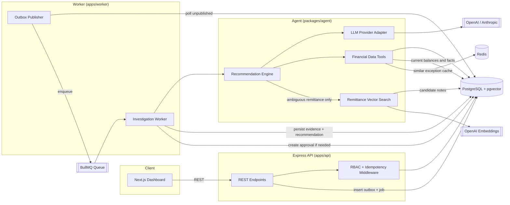

# CashFlow Architecture

CashFlow is a cash application reconciliation system. It detects mismatches between
invoices and payments, lets analysts trigger an AI investigation, and routes the AI's
recommendation through an approval workflow before any downstream action is applied.

## System Diagram

## End-to-End Data Flow

1. **Detection** – `detectExceptions()` scans customers and classifies issues
   (unapplied payments, amount mismatches, overpayments, timing issues) writing rows
   to `exceptions`.
2. **Investigation request** – an analyst calls `POST /api/exceptions/:id/investigate`.
   The API, inside a single transaction:
   - inserts a `jobs` row (waiting),
   - inserts an `investigations` row (pending),
   - sets the exception to `investigating`,
   - writes an `investigation.requested` event to the **outbox**,
   - writes an `audit_logs` row.
3. **Reliable delivery** – the worker's **outbox publisher** polls unpublished outbox
   rows with `FOR UPDATE SKIP LOCKED`, enqueues a BullMQ job, and marks the event
   published (at-least-once).
4. **Agent run** – the investigation worker invokes the agent. The agent uses a
   tool-calling loop against the LLM (or a deterministic rule-based fallback when no
   API key is configured) to gather evidence. It fetches a bundled financial context,
   uses a 15-second Redis cache only for similar-exception history, and can search
   synthetic remittance text with pgvector when references are ambiguous. Current
   balances always come from PostgreSQL. It then produces a structured
   recommendation: `action`, `confidence`, `rationale`, `evidence_refs`,
   `suggested_adjustments`.
5. **Persistence** – the worker stores the recommendation and full evidence trail on
   `investigations`, sets the job to `completed`, and:
   - if `action = release`, auto-resolves the exception,
   - otherwise sets `pending_approval` and creates an `approvals` row.
6. **Approval & action** – an approver calls `PATCH /api/approvals/:id`. On approval,
   the action executor persists `adjustments`, resolves the exception, writes an audit
   log, and emits `exception.resolved` to the outbox (simulated downstream integration).

## Reliability Patterns

- **Transactional outbox** – state changes and events commit atomically; the publisher
  provides at-least-once delivery, decoupling the API from Redis availability.
- **Idempotency** – write endpoints accept an `Idempotency-Key` header. Responses are
  stored and replayed, and concurrent duplicates receive `409`.
- **Idempotent workers** – the DB `jobs` row tracks status; a completed job is skipped if
  a message is redelivered.
- **Retries with backoff** – BullMQ retries failed agent runs with exponential backoff;
  terminal failures reset the exception to `open` and record the error.
- **Immutable audit trail** – significant actions append to `audit_logs`.

## RBAC

Roles: `viewer` < `analyst` < `approver` < `admin`. Requests carry `x-user-id` and
`x-user-role` (the dashboard exposes a role selector).

| Action | Minimum role |
| ------ | ------------ |
| List / view exceptions, jobs, audit | viewer |
| Trigger investigation, create/resolve exceptions, create approvals | analyst |
| Approve / reject approvals | approver |

## Key Tables

`customers`, `invoices`, `payments`, `invoice_payments`, `exceptions`,
`exception_rules`, `investigations`, `jobs`, `approvals`, `audit_logs`, `outbox`,
`idempotency_keys`, `adjustments`.

`remittance_documents` stores synthetic remittance notes and 1536-dimensional embeddings.
Semantic matches are candidate evidence only; the agent must verify invoice/payment IDs and
amounts with exact PostgreSQL tools before recommending an adjustment.
